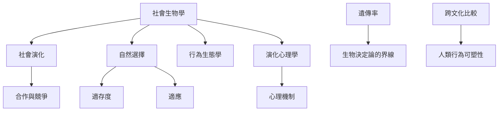

社會生物學以演化方式研究社會行為，但其解釋必須區分演化層次、近因機制、發育與文化脈絡。這張地圖連接社會生物學的歷史起點、方法論邊界與相關學科。

## 相關概念
* [[社會生物學 Sociobiology]]、[[社會演化 Social evolution]]、[[自然選擇 Natural selection]]、[[適存度 Fitness]]、[[適應 Adaptation]]
* [[行為生態學 Behavioral ecology]]、[[演化心理學 Evolutionary psychology]]、[[遺傳率 Heritability]]、[[生物決定論 Biological determinism]]、[[跨文化比較 Cross-cultural comparison]]
* [[社會生物學研究的是社會行為如何演化而非替行為貼上基因標籤]]、[[遠因與近因是理解社會行為不可互相取代的兩種問題]]

## 延伸閱讀
* [[威爾森以跨物種比較建立社會生物學研究綱領]]
* [[演化心理學經典文集嘗試連接演化機制與文化生成]]
* [[古爾德與勒旺廷要求適應論提出可檢驗證據]]

## 相關地圖
* [[解釋合作與利他的演化機制]]
* [[人類社會文化演化的基因與文化互動]]
* [[社會生物學的歷史爭論與批判方法]]
