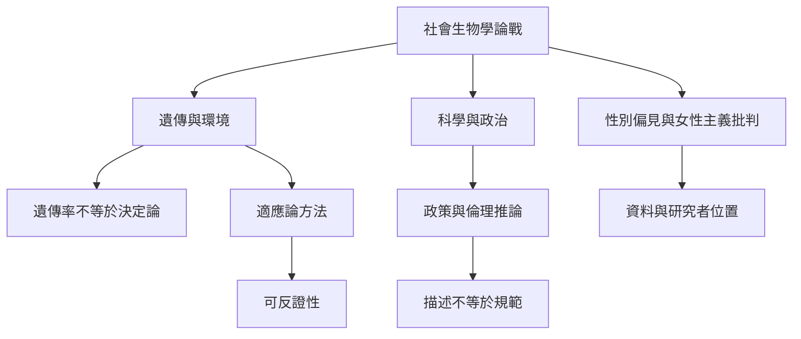

社會生物學的爭論不只關於演化模型，也關於如何將動物研究延伸到人類、誰的經驗被納入資料，以及科學描述如何被轉譯成政治與倫理主張。這張地圖整理適應論、決定論、女性主義批判與社會科學檢驗。

## 相關概念
* [[生物決定論 Biological determinism]]、[[遺傳率 Heritability]]、[[適應 Adaptation]]、[[自然選擇 Natural selection]]
* [[跨文化比較 Cross-cultural comparison]]、[[社會規範 Social norm]]
* [[生物學事實不能單獨推出社會應然]]、[[適應性解釋不能將既存不平等自然化]]、[[性別角色的演化解釋需納入女性主義與社會歷史]]

## 延伸閱讀
* [[古爾德與勒旺廷要求適應論提出可檢驗證據]]
* [[女性主義史料揭示社會生物學論戰曾忽略女性批判者]]
* [[五十年後的回顧顯示社會生物學論戰從未只是學術私怨]]
* [[用可反證問題檢查每一個演化故事]]

## 相關地圖
* [[社會生物學的核心問題與學科邊界]]
* [[解釋合作與利他的演化機制]]
* [[人類社會文化演化的基因與文化互動]]
