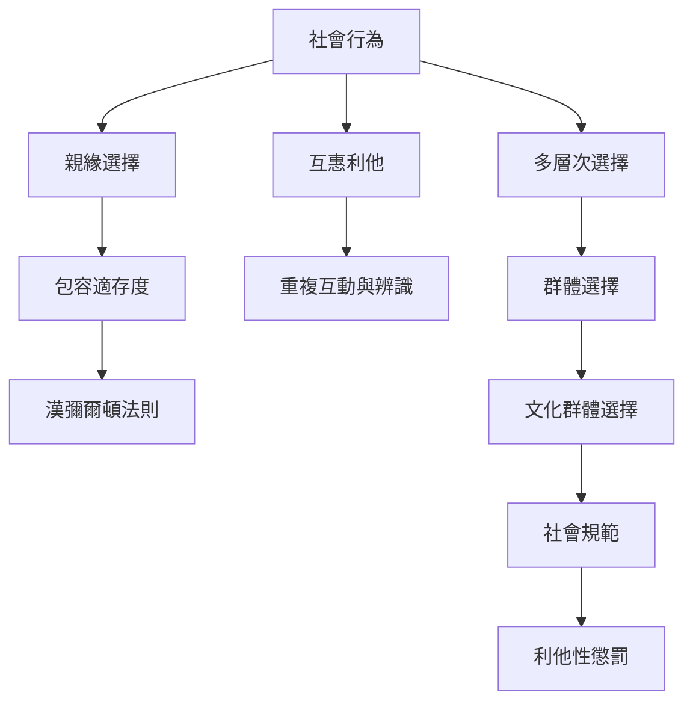

合作與利他不是單一現象。親緣關係、重複互動、規範執行、群體層次差異與文化傳承，可能在不同情境中交互作用。這張地圖將核心機制並列，避免以單一理論解釋所有合作。

## 相關概念
* [[親緣選擇 Kin selection]]、[[包容適存度 Inclusive fitness]]、[[漢彌爾頓法則 Hamilton's rule]]
* [[互惠利他 Reciprocal altruism]]、[[多層次選擇 Multilevel selection]]、[[群體選擇 Group selection]]
* [[文化群體選擇 Cultural group selection]]、[[社會規範 Social norm]]、[[利他性懲罰 Altruistic punishment]]、[[真社會性 Eusociality]]
* [[親緣選擇只解釋合作的一種條件而非所有利他]]、[[人類合作依賴制度與文化而不只是親屬關係]]

## 延伸閱讀
* [[漢彌爾頓以包容適存度說明親緣利他如何可能演化]]
* [[特里弗斯以互惠利他解釋非親屬合作的演化條件]]
* [[費爾與蓋克特的實驗顯示利他性懲罰可穩定合作]]
* [[史密斯指出文化群體選擇解釋合作仍有概念與經驗缺口]]

## 相關地圖
* [[社會生物學的核心問題與學科邊界]]
* [[人類社會文化演化的基因與文化互動]]
* [[社會生物學的歷史爭論與批判方法]]
