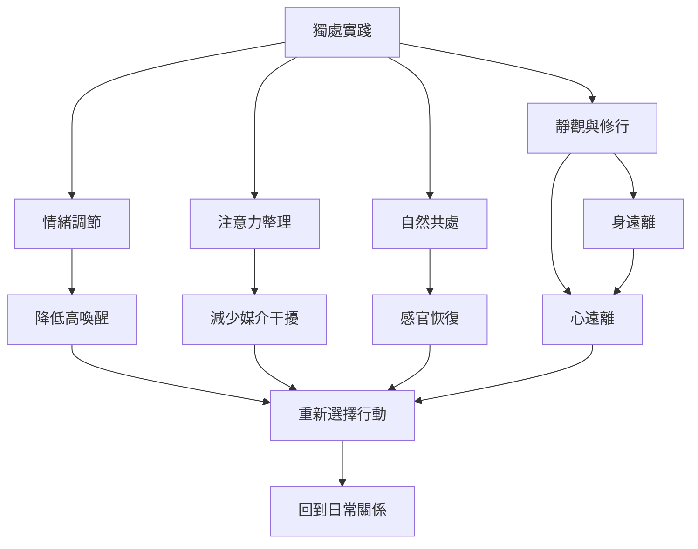

獨處實踐可依目的分成情緒降速、注意力整理、身體恢復、自然感知與靈性觀照。這些活動不保證產生相同結果，適合依個人需求、環境與安全條件調整。

## 思與行
* 將 [[獨處能降低情緒喚醒卻不保證增加愉悅]] 與 [[自然環境讓獨處同時成為感官活動與恢復過程]] 作為實驗依據。
* 以 [[修行中的遠離必須從外在空間延伸到心的活動]] 作為靜坐或無手機散步的反思框架。

## 參考
* 研究與經典：[[自願獨處能降低高喚醒情緒，主動選擇是重要條件]]、[[佛教修行將身體遠離與心的遠離視為兩個不同層次]]。
