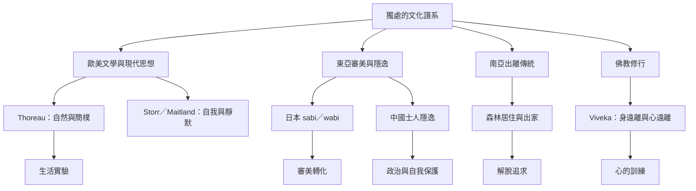

人類對獨處的理解並非跨文化固定不變。西方文學中的自然隱居、日本美學中的寂與侘、印度出家與森林修行、佛教遠離，以及中國士人的隱逸，都把個人與世界的距離放進不同的倫理、宗教、政治與審美脈絡。

## 思與行
* 閱讀 [[日本美學中的寂與侘呈現孤寂感的審美轉化]] 與 [[中國士人的歸隱同時是生活選擇與政治社會關係]]，比較審美與政治語境。
* 將不同傳統視為互相對話的入口，而不是把各文化壓縮成同一種「孤獨智慧」。

## 參考
* 文獻與作品：[[經典與當代散文把獨處描寫成需要練習也需要支撐的生活技藝]]、[[佛教修行將身體遠離與心的遠離視為兩個不同層次]]。
