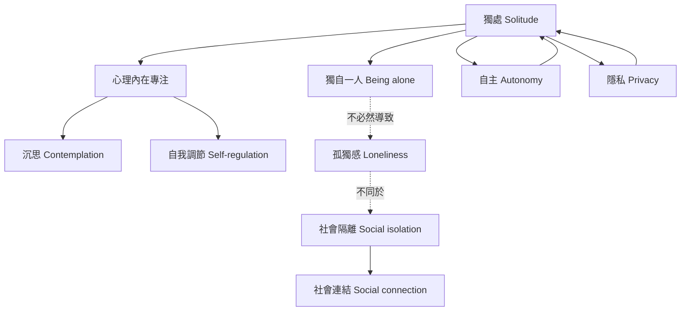

本圖從獨處的核心定義出發，區分物理上獨自一人、主觀孤獨感與客觀社會隔離，再連結自主、隱私、注意力與沉思。獨處不是單一人格類型，而是受到動機、環境與關係條件影響的經驗。

## 思與行
* 先用 [[Solitude]]、[[Being_alone]]、[[Loneliness]] 與 [[Social_isolation]] 建立基本詞彙，再閱讀 [[獨處的品質首先取決於是否具有選擇權]]。
* 用 [[身體獨處不等於心理獨處]] 檢查日常生活中的數位連線與注意力。

## 參考
* 綜述：[[獨處具有多種正向功能，但其價值取決於情境與個體差異]]。
* 定義研究：[[日常獨處是自我成為注意力中心，不只等於物理上的獨自一人]]。
