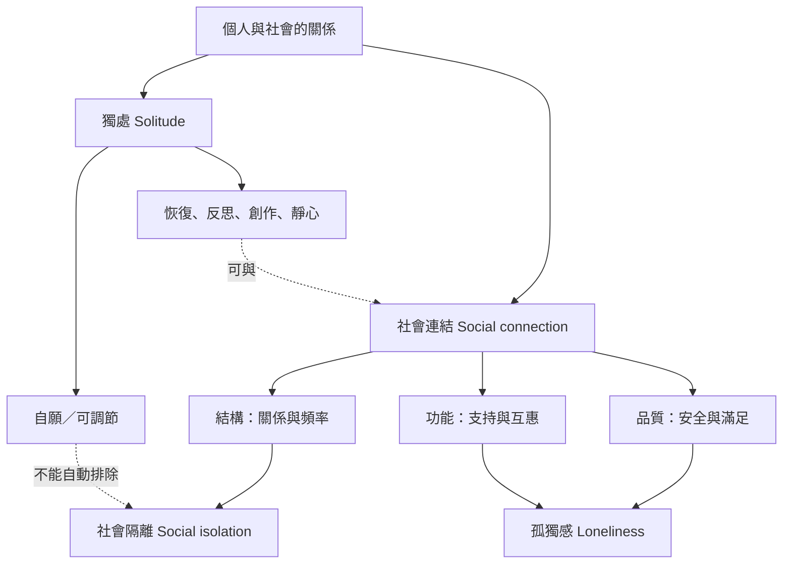

這張地圖將「獨處」與「社會連結」放在同一個系統內思考。獨處偏向個人如何安排注意力與互動距離；社會連結則涉及關係結構、支持功能與互動品質。兩者可以並存，不能用獨處時數直接推論孤獨或隔離。

## 思與行
* 閱讀 [[偏好獨處不能抵銷長期社會隔離造成的風險]]，避免將獨處浪漫化。
* 以 [[自願退出與被排除的差異也是權力與資源問題]] 檢查社群中的選擇權。

## 參考
* WHO 2025：[[世界衛生組織將孤獨與社會隔離視為不同的社會連結問題]]。
* 健康證據：[[九十項世代研究顯示社會隔離與孤獨感都和較高死亡風險相關]]。
