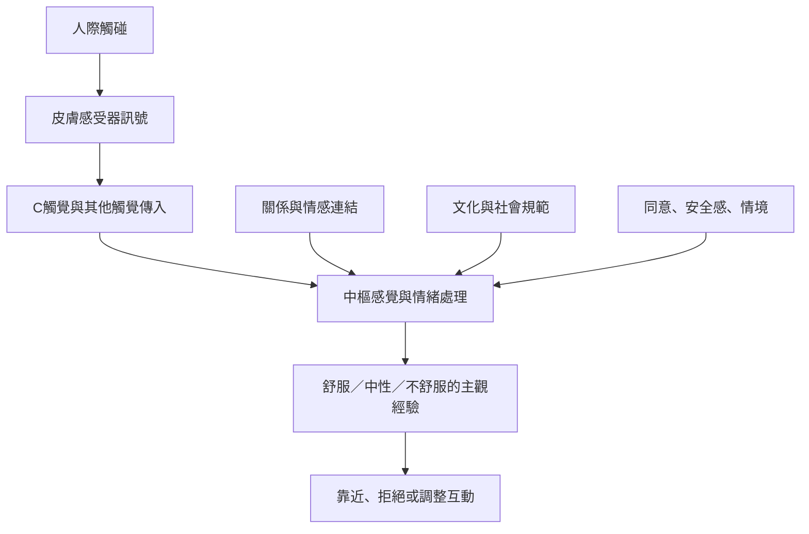

社會觸覺是具有關係意義的人際接觸。C-tactile纖維與輕柔撫觸相關，但情感評價還受其他觸覺輸入、關係品質、文化與同意影響。相同接觸不會對所有人、所有情境產生相同感受。

延伸筆記：[[情感觸覺同時依賴周邊訊號與關係情境]]、[[社會觸碰需要同意且受到文化與關係脈絡調節]]、[[觸碰偏好需要把跨文化平均趨勢和個人界線分開]]。詞條：[[情感觸覺]]、[[C觸覺傳入纖維]]、[[社會觸覺]]。
