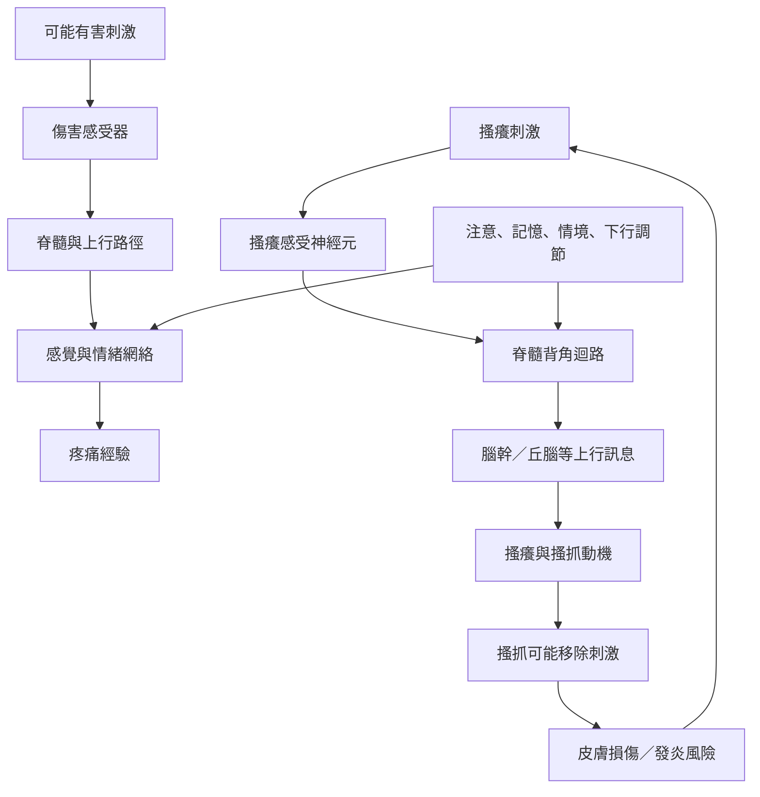

疼痛與搔癢都可能具有保護功能，但其周邊受器、脊髓迴路與主觀結果並不相同。疼痛特別需要區分傷害感受與主觀感覺／情緒經驗；搔癢則與搔抓動機密切相關，慢性狀態可能形成循環。

重點筆記：[[疼痛經驗不能簡化為傷害感受器的放電]]、[[搔癢是防禦性體感覺而慢性搔抓可能形成循環]]、[[脊髓搔癢迴路會整合興奮抑制與下行調節]]。詞條：[[疼痛]]、[[傷害感受]]、[[傷害感受器]]、[[搔癢]]、[[觸覺性異痛]]。
