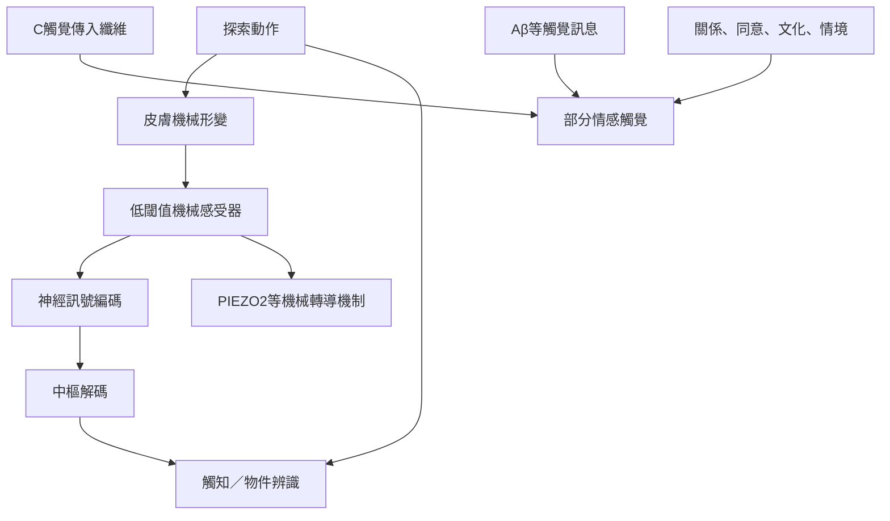

觸覺處理由多種皮膚機械感受器啟動，但日常觸知還依賴主動探索：手如何移動、施力與改變接觸角度，會決定能取樣到什麼資訊。辨識性觸覺和情感觸覺彼此互動，卻不是同一個構念。

延伸閱讀[[機械感受器把不同皮膚形變轉換成神經訊號]]、[[觸知是主動動作和感覺資訊共同構成的探索]]、[[觸覺辨識與觸碰的情感價值是相互關聯但不同的面向]]。術語可參考[[觸覺]]、[[機械感受器]]、[[觸知]]、[[C觸覺傳入纖維]]。
