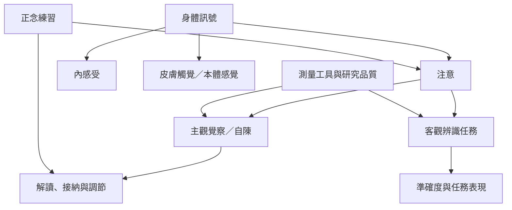

「身體覺察」涵蓋多種能力與態度：注意內部訊號、辨認觸覺或位置、解讀感受、接納身體變化，以及依訊息調整行動。研究若只測量某一種內感受量表，不能推論所有體感覺能力都提升。

將[[內感受處理身體內部狀態，與體感覺相關但不可混同]]、[[正念練習可能改變主觀內感受，但不等於客觀體感覺準確度提高]]與[[每天用三分鐘辨識一種身體訊號可建立更精確的感覺語彙]]一起閱讀。詞條：[[內感受]]、[[體感覺]]、[[本體感覺]]。
