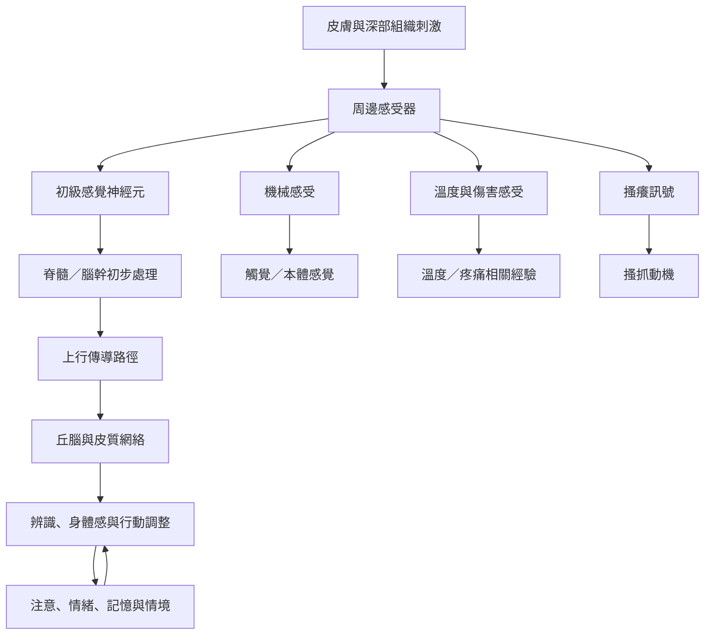

體感覺系統可沿著「刺激—受器—傳入神經—脊髓／腦幹—丘腦—皮質與其他網絡—知覺與行動」理解。這條主幹之上，機械感受、溫度、傷害感受與搔癢等訊息具有不同受器和路徑；最終身體經驗則受到注意、情緒、記憶和情境調節。

核心閱讀從[[體感覺系統是多條感覺通道的整合，而不是單一觸覺]]開始，再閱讀[[精細觸覺與疼痛溫度主要經由不同上行路徑傳遞]]。重要概念詞條包括[[體感覺]]、[[機械感受器]]、[[本體感覺]]、[[傷害感受]]與[[內感受]]。
