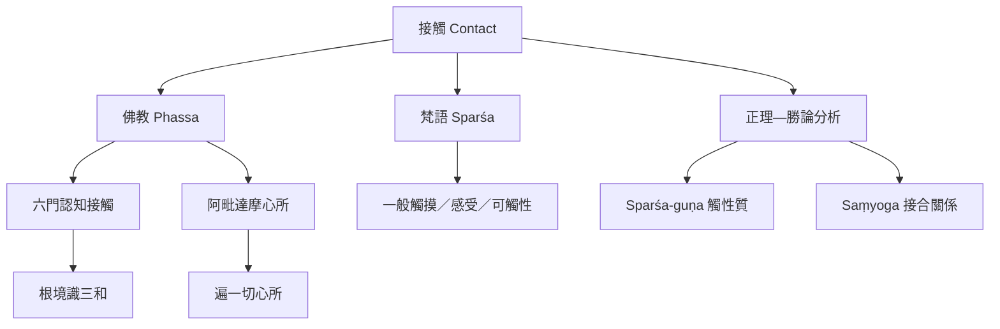

此概念地圖比較不同語言與哲學傳統中的「觸／接觸」。佛教 phassa 主要用於六門認知接觸或心所分析；梵語 sparśa 的一般語義較寬；正理—勝論又區分作為觸覺性質的 sparśa-guṇa 與作為接合關係的 saṃyoga。相同的英文翻譯 touch/contact 不代表概念相同。

概念連結：[[term/Sparśa（梵語觸）]]、[[term/Phassa（巴利語觸）]]、[[term/Sparśa-guṇa（觸性）]]、[[term/Saṃyoga（接合關係）]]、[[term/Trikasaṅgati（三和）]]、[[term/Cetasika（心所）]]。

延伸筆記：[[note/中文的觸同時指觸覺境界與認知心所]]、[[note/Sparśa 的一般梵語語義比佛教技術術語更寬廣]]、[[note/印度正理勝論區分觸的性質與事物接合的關係]]。

依據：[[data/《摩尼爾威廉梵英詞典》顯示 sparśa 橫跨觸感接觸與感受等語義]]、[[data/正理與勝論以 saṃyoga 表示接合關係並以 sparśa 表示觸性]]、[[data/佛學辭典以根境識三和與五境觸性區分不同的觸義]]。

本概念收錄於[[Sparśa]]。
