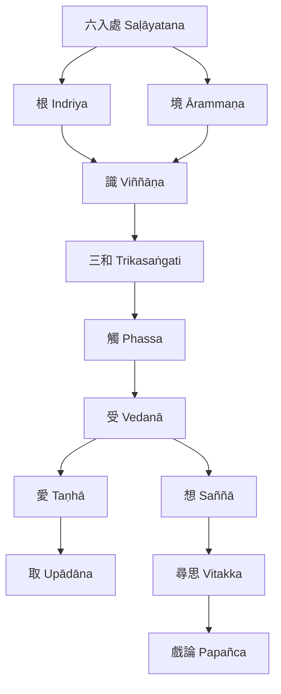

此概念地圖以早期佛教經文為主線，呈現六入處如何提供感官條件，根、境、識相應而有觸，觸緣受，之後可能出現愛與取；MN 18 又補充受、想、思考與戲論的擴張路徑。兩條線索相關但不是完全相同的經文公式，應分別保留其文本脈絡。

概念連結：[[term/Phassa（巴利語觸）]]、[[term/Saḷāyatana（六入處）]]、[[term/Trikasaṅgati（三和）]]、[[term/Vedanā（受）]]、[[term/Saññā（想／辨識）]]、[[term/Papañca（戲論）]]、[[term/Paṭiccasamuppāda（緣起）]]。

延伸筆記：[[note/觸是認知事件的節點而不只是皮膚碰觸]]、[[note/觸緣受描述條件關係而非固定的情緒命運]]、[[note/觸之後的戲論會把當下經驗擴張成自我故事]]。

本圖依據[[data/《相應部 SN 12.2》將觸界定為六種感官接觸並置於受之前]]與[[data/《中部 MN 18 蜜丸經》以觸為感受、辨識與戲論展開的起點]]；閱讀根本經文時，請注意不同經文的鏈條並不完全一致。

本概念收錄於[[Sparśa]]。
