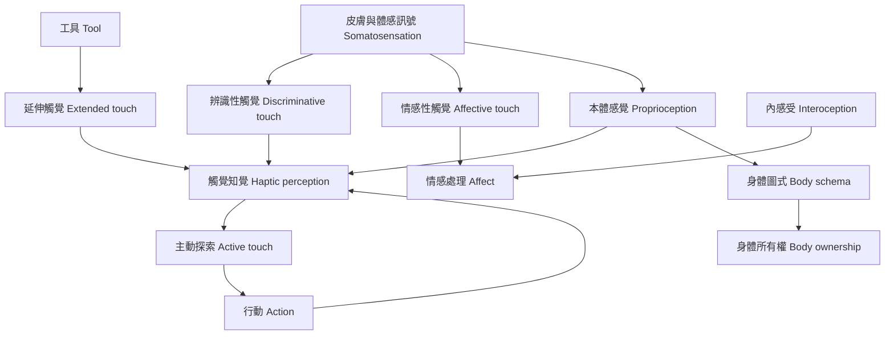

此圖聚焦現代觸覺研究：體感訊號、主動探索與行動控制共同支持物件辨識、身體表徵、情感價值和工具延伸。辨識性觸覺與情感性觸覺是研究上有用的區分，但實際經驗中可能交互作用；本體感覺、內感受與身體所有權也彼此相關而不可互換。

概念連結：[[term/Somatosensation（體感）]]、[[term/Haptic perception（觸覺知覺）]]、[[term/Active touch（主動觸摸）]]、[[term/Affective touch（情感性觸覺）]]、[[term/Discriminative touch（辨識性觸覺）]]、[[term/C-tactile afferent（C 觸覺傳入纖維）]]、[[term/Proprioception（本體感覺）]]、[[term/Interoception（內感受）]]、[[term/Extended touch（延伸觸覺）]]。

延伸筆記：[[note/主動觸摸把動作納入感知本身]]、[[note/觸覺使身體既是感知工具也是可能被感知的對象]]、[[note/情感性觸覺具有生理線索但不能簡化成單一神經纖維]]、[[note/熟練工具能把觸覺探索延伸到皮膚之外]]。

主要依據：[[data/2023 年觸覺研究回顧顯示身體表徵不只由皮膚拓樸圖決定]]、[[data/C-tactile 研究顯示溫柔觸碰具有情感維度但不等於愉悅]]、[[data/2025 年觸覺知覺回顧強調感知與行動的互惠關係]]。

本概念收錄於[[Sparśa]]。
