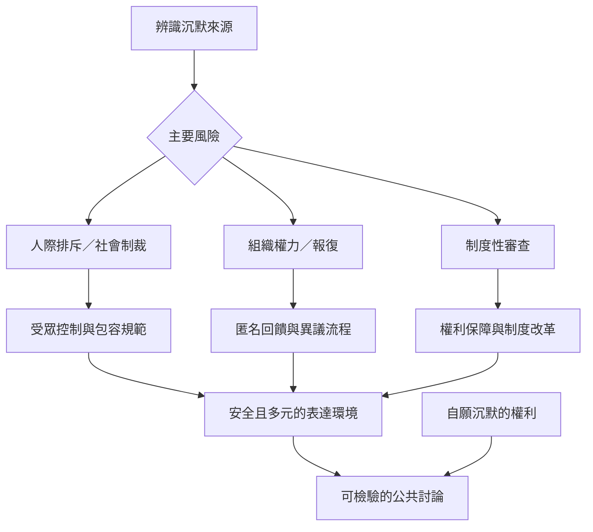

這張地圖把理論分析轉成制度與社群實踐：既保護異議者發言，也保護個人選擇不公開表態的權利。

連結：[[心理安全感]]、[[公共領域]]、[[多元主義]]、[[組織沉默]]、[[制度化的異議管道比鼓勵勇敢更可靠]]、[[把不發言的權利與安全發言的條件一起保護]]、[[建立一個看得見少數聲音又不製造假代表性的公共討論]]。

## 參考
- [[制度化的異議管道比鼓勵勇敢更可靠]]。
- [[包容的社群規範能降低少數意見者的自我審查]]。
- [[少數意見需要被聽見但不代表所有意見都值得放大]]。
- 本主題導讀：[[Spiral_of_silence]]。
