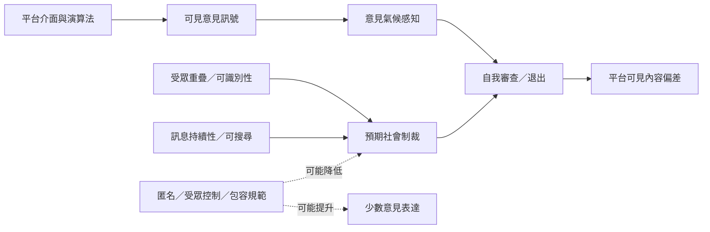

數位平台不只提供發言空間，也透過留言、排序、人氣指標、受眾重疊、可識別性與訊息留存改變使用者估計意見氣候及評估表達成本。

連結：[[資訊繭房]]、[[意見氣候]]、[[自我審查]]、[[社會制裁恐懼]]、[[意見表達]]、[[公開可見的聲量不能直接當成真實民意]]、[[平台設計會把意見氣候變成可見的社會訊號]]、[[為社群設計發言風險分級與受眾控制]]。

## 參考
- [[Pew調查顯示美國人對監控議題在線上比面對面更不願發言]]。
- [[香港研究顯示公開性與意見分歧會加劇社群平台沉默]]。
- [[Reddit研究把未公開的少數意見納入社群分析]]。
- 本主題導讀：[[Spiral_of_silence]]。
