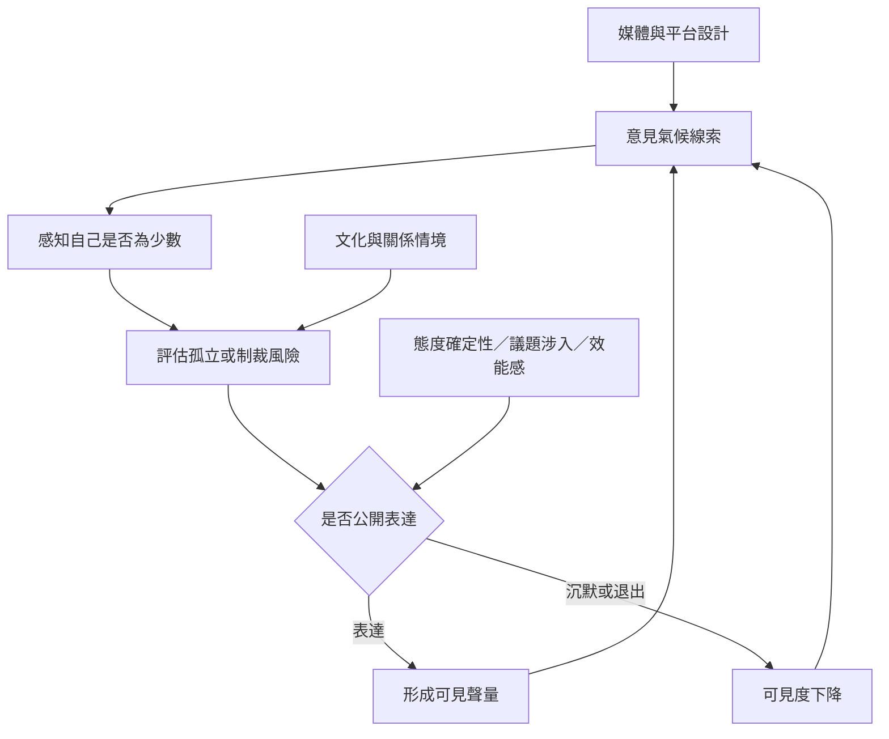

此圖聚焦個人如何感知意見氣候、評估社會代價，並決定是否公開表達。它不是線性必然過程；態度確定性、議題涉入、效能感與情境都可能改變各環節。

連結：[[沉默螺旋]]、[[意見氣候]]、[[孤立恐懼]]、[[自我審查]]、[[社會制裁恐懼]]、[[意見表達]]、[[沉默螺旋是意見氣候與公開表達之間的回饋循環]]、[[態度確定性會調節意見氣候對表達的影響]]。

## 參考
- [[1974年原典把沉默描述為意見氣候中的動態回饋]]。
- [[統合分析發現意見支持度與表達意願的關係穩定但幅度不大]]。
- [[政治多元的社群網絡可能增加社會制裁恐懼]]。
- 本主題導讀：[[Spiral_of_silence]]。
