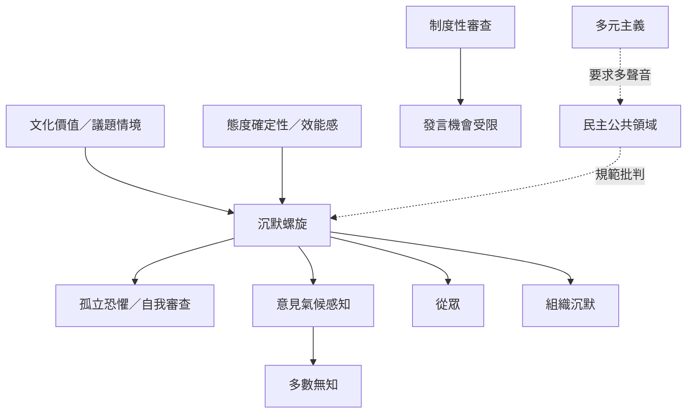

沉默螺旋需要放在多種相鄰概念與批判傳統中理解。此圖區分相似現象、可調節條件與規範批判，避免把所有沉默現象都歸到同一理論。

連結：[[多數無知]]、[[從眾]]、[[組織沉默]]、[[公共領域]]、[[多元主義]]、[[心理安全感]]、[[制度性審查與人際沉默必須分開分析]]、[[沉默螺旋是分析框架而不是判定他人動機的捷徑]]。

## 參考
- [[多數無知與沉默螺旋會互相強化但分析焦點不同]]。
- [[組織沉默研究把集體不發聲連結到權力與組織文化]]。
- [[沉默螺旋的創始者與理論史也需要批判性檢視]]。
- 本主題導讀：[[Spiral_of_silence]]。
