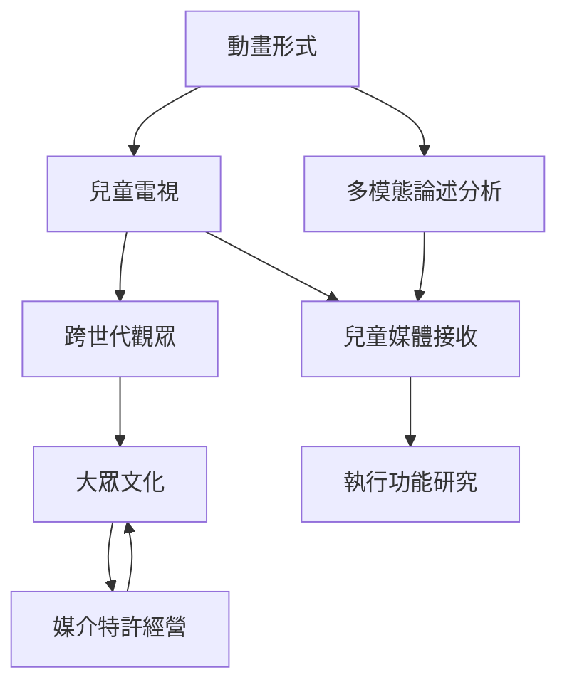

這張概念地圖把《海綿寶寶》放在動畫形式、兒童電視產業、跨世代觀眾與兒童認知研究的交會處。閱讀時應同時分辨作品形式、產業條件、觀眾理解與實驗研究的證據層級。

- [[動畫]]
- [[兒童電視]]
- [[執行功能]]
- [[受眾研究]]
- [[接收理論]]
- [[大眾文化]]
- [[媒介特許經營]]
- [[尼克兒童頻道的經濟與觀眾策略有助理解海綿寶寶的跨世代魅力]]
- [[兒童觀看研究必須區分短期效果與長期發展]]

全書脈絡：[[SpongeBob_SquarePants|全書導讀]]。
