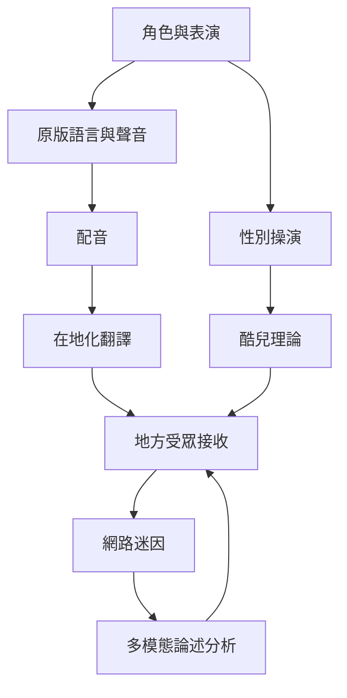

同一角色的聲音、親密關係、服飾與姿態，會在文本、配音、地方規範和觀眾詮釋中產生不同意義。這張圖把酷兒閱讀、性別操演、配音翻譯、受眾研究與迷因文化放在同一個跨文化脈絡。

- [[酷兒理論]]
- [[性別操演]]
- [[配音]]
- [[在地化翻譯]]
- [[接收理論]]
- [[網路迷因]]
- [[多模態論述分析]]
- [[全球作品透過在地化成為地方文化的一部分]]
- [[角色的性別曖昧提供酷兒閱讀空間但不等同於身份定論]]

全書脈絡：[[SpongeBob_SquarePants|全書導讀]]。
