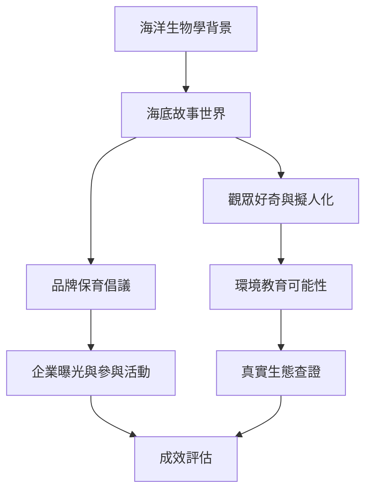

作品的海洋生物來源、海底生活世界與企業保育倡議，構成三種不同層次：創作靈感、故事文本和現實行動。這張圖提醒讀者不可把三者混為一談，應以真實生態知識與可驗證成效評估環境教育價值。

- [[環境教育]]
- [[動畫]]
- [[消費主義]]
- [[海底小鎮同時是生態系統與社會制度的縮影]]
- [[海洋生物設定不等於作品本身就是環境教育]]
- [[海綿寶寶海洋保育活動呈現品牌倡議與環境教育的雙重可能]]

全書脈絡：[[SpongeBob_SquarePants|全書導讀]]。
