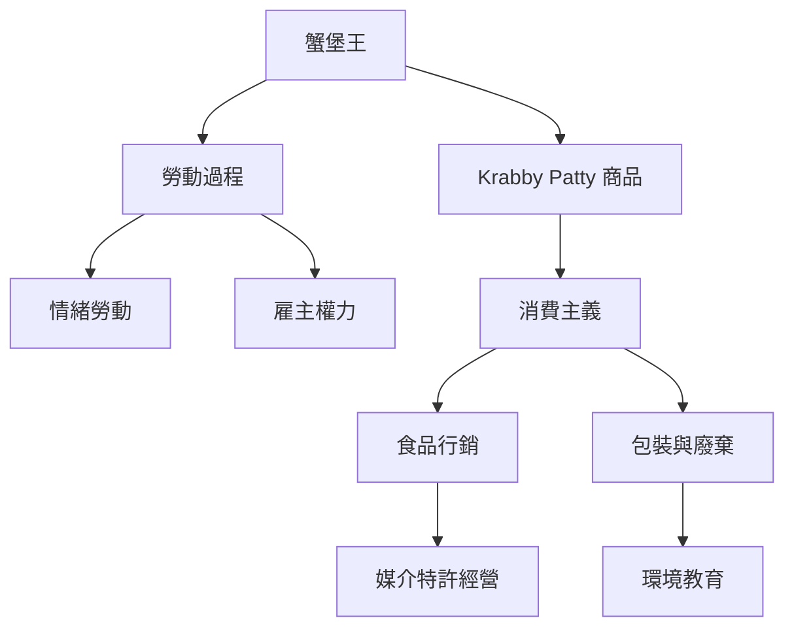

比奇堡的食物與工作場景可同時用來理解勞動分工、服務情緒、商品競爭、食品行銷與廢棄問題。這張圖從蟹堡王出發，將個人角色的行動連結到更大的經濟和生態系統。

- [[勞動過程理論]]
- [[情緒勞動]]
- [[消費主義]]
- [[環境教育]]
- [[蟹堡王把服務業勞動變成可見的日常喜劇]]
- [[食物笑料讓速食文化的消費鏈條浮現]]
- [[品牌保育倡議必須同時檢查公共效益與商業收益]]

全書脈絡：[[SpongeBob_SquarePants|全書導讀]]。
