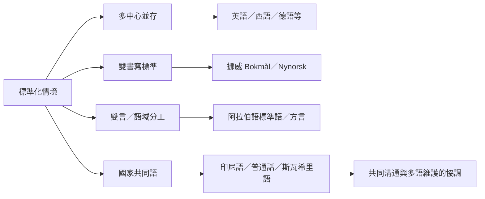

不同地區的語言歷史呈現不同的標準化方式：多中心標準、雙書寫標準、雙言功能分工、國家共同語與地方語言共存，以及標準語與國族建構的連動。

比較材料見[[多中心語言讓不同國家的標準可以同時具有正當性]]、[[挪威的雙書寫標準顯示統一不是標準化唯一可能]]、[[阿拉伯語的高低變體分工顯示標準語可能是特定語域資源]]、[[印尼語成為國家語言的過程必須放在多語社會與國家整合中理解]]與[[斯瓦希里語標準化的歷史早於殖民政府的正式規劃]]。
