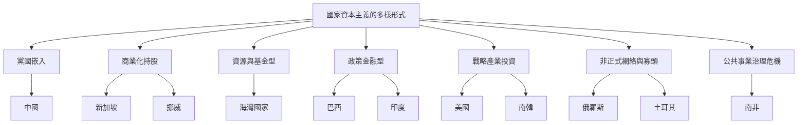

各國不是同一套國家資本主義模式，而是由歷史、政治制度、企業結構與國家能力交織而成的制度組合。這張地圖用不同案例呈現國家介入資本的路徑。

比較時可從[[國家資本主義的成效取決於制度能力而非國有比例本身]]開始，再閱讀[[國家資本主義並非威權政體的專屬現象]]及[[國家資本主義的全球擴張改變了國際競爭與經濟安全議題]]。案例文獻見[[中國國家資本主義正由國有企業中心轉向黨國嵌入式治理]]、[[新加坡以政府關聯企業與專業化投資機構形成商業型國家資本主義]]、[[挪威的國家持股把財務報酬與公共政策目標分成不同類別]]、[[俄羅斯的國家資本主義與寡頭資本主義呈現國家權力和私人財富的共生]]、[[巴西透過國有企業政策銀行與國家投資機構持續影響私人資本]]、[[印度的國家資本主義在自由化後轉向資源控制與選擇性扶植]]、[[土耳其的國家滲透型資本主義依賴國家與商業網絡的互相依存]]、[[南韓綠色產業政策顯示國家能力仍受企業結構性權力制約]]、[[南非Eskom危機顯示國有企業可能成為分配衝突與治理失靈的節點]]及[[美國國家資本主義正在透過企業股權與產業政策呈現新形式]]。
