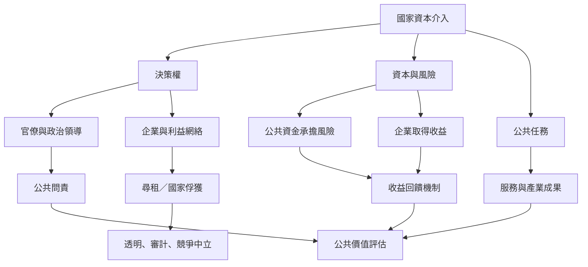

國家資本主義最重要的政治問題，不只是國家持有多少資產，而是誰能決定投資、誰獲得收益、誰承擔成本，以及公共決策能否被檢驗。這張地圖把權力、風險與問責連在一起。

延伸閱讀[[國家與企業的緊密關係既能協調投資也能創造尋租空間]]、[[公共投資的成果應回饋公共價值]]、[[國家資本主義研究必須把勞工與使用者經驗納入宏觀分析]]與[[國家資本主義的批判必須同時檢查市場與國家的權力]]。概念基礎包括[[國家俘獲]]、[[尋租]]、[[公共價值]]、[[競爭中立]]與[[國家能力]]。
