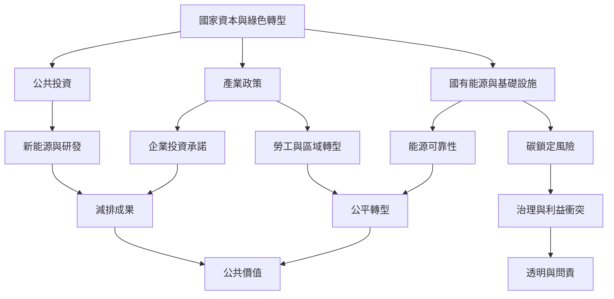

國家資本在能源、交通、礦產與金融部門具有關鍵地位，因此可能推動減碳，也可能延續既有高碳結構。綠色轉型的成敗取決於國家投資工具、企業權力與公共問責能否共同調整。

從[[國家資本主義的綠色轉型必須檢查權力分配與碳鎖定]]出發，連結[[南韓綠色產業政策顯示國家能力仍受企業結構性權力制約]]、[[南非Eskom危機顯示國有企業可能成為分配衝突與治理失靈的節點]]與[[海灣主權財富基金已成為國內發展工具與政權穩定機制]]。核心概念為[[綠色轉型]]、[[工業政策]]、[[公共價值]]及[[企業結構性權力]]。
