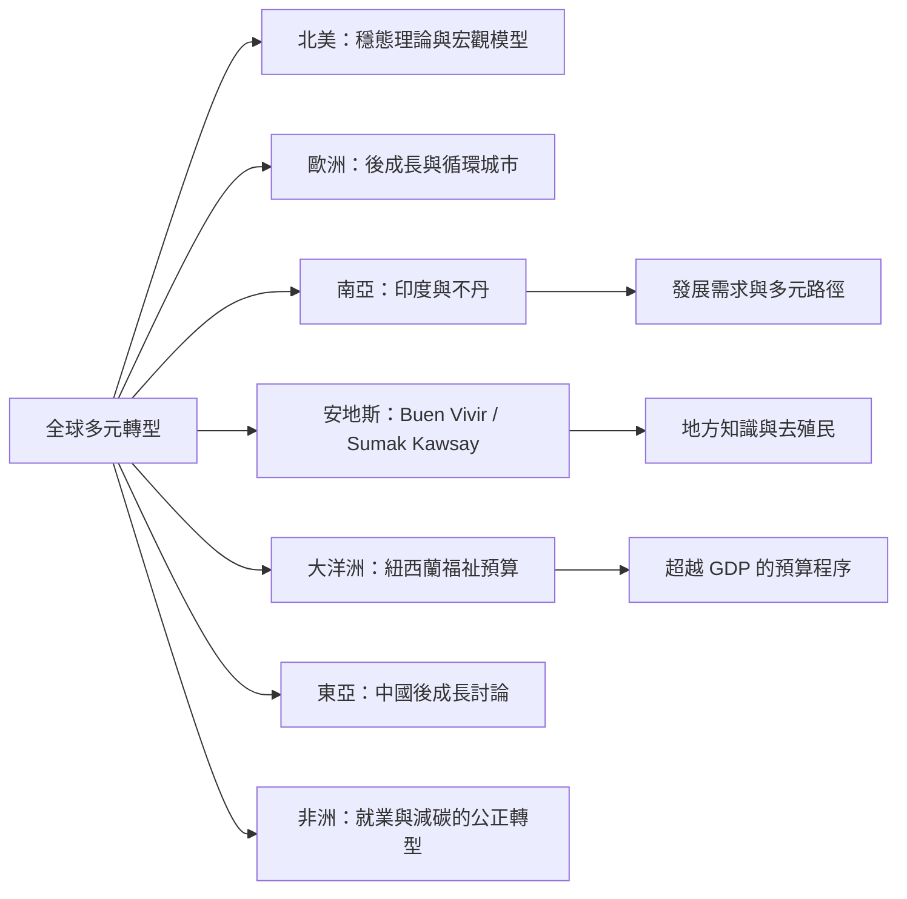

不同地區的福祉預算、國民幸福衡量、循環城市、原住民族生活觀與就業—減碳政策，可作為穩態經濟的比較材料。它們不是同一種制度，也不必然是穩態經濟的完整案例。

## 雙向連結
* [[Buen Vivir]]、[[地方知識]]、[[後發展]]、[[全球南方]]
* [[國民幸福總值]]、[[福祉經濟]]、[[循環經濟]]、[[公正轉型]]
* [[Buen Vivir 不能被直接等同於穩態經濟]]
* [[地方福祉實踐不能被誤認為穩態經濟的完成案例]]
* [[穩態經濟需要全球差異化的公平轉型]]
