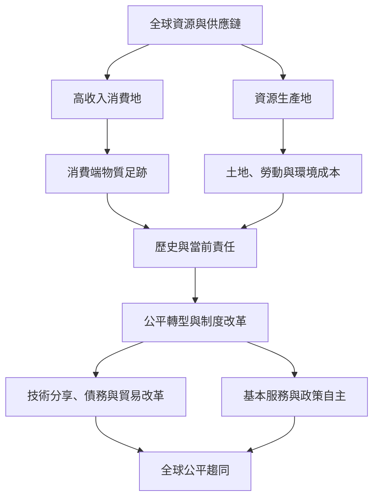

穩態經濟的全球正義問題，是如何避免讓高消費社會的轉型成本由資源生產地、低收入勞工或仍缺乏基本服務的群體承擔。全球北方與全球南方的起點不同，國家內部的所得與消費差距也很大；因此需要把歷史責任、消費端足跡、資源主權、債務、技術與發展空間放入分析。

**核心概念：** [[Just_transition]]、[[Buen_Vivir]]、[[Gross_National_Happiness]]、[[Post_growth]]、[[Sufficiency]]、[[Material_footprint]]。

**永久筆記：** [[全球南方需要發展空間與全球制度改革]]、[[穩態轉型必須同時處理全球供應鏈與權力關係]]、[[不丹幸福治理顯示福祉指標必須接受文化與權力批判]]。

這張卡片是 [[Steady-state_economy]] 全書論證的一部分。

## 思與行
- 比較政策時，避免把富裕國家的消費削減路徑直接套用到基本服務仍不足的國家。
- 追蹤採購與投資背後的供應鏈責任，把勞動、土地、債務與政治自主納入正義評估。

## 參考
- [[印度與不丹經驗提醒後成長必須立足全球南方脈絡]]、[[拉丁美洲去殖民觀點要求改革全球貿易與資源權力]]、[[全球南方後成長研究必須同時處理依賴的動機與障礙]]、[[中國的高質量發展與生態文明需要納入後成長討論]]。
