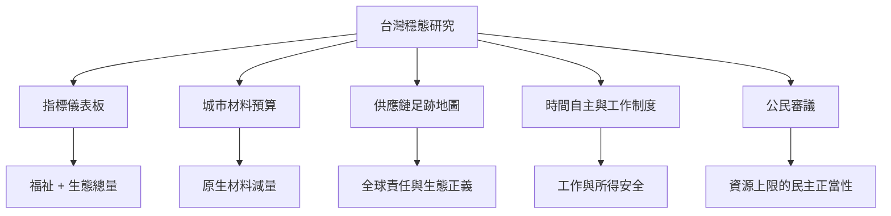

台灣可將穩態經濟轉化為一項持續的公共研究計畫：先建立可重現的生態與福祉儀表板，再以城市材料預算、供應鏈足跡、工作時間與公民審議進行地方試驗。這張地圖將概念連到可執行的研究問題。

## 雙向連結
* [[為台灣建立一張同時衡量福祉與生態總量的穩態儀表板]]
* [[以城市材料預算讓生態上限變成可討論的公共數字]]
* [[建立全球供應鏈的生態債與責任地圖]]
* [[把時間自主納入穩態經濟的繁榮定義]]
* [[用公民審議決定地方資源上限與配額分配]]
* [[以三種情境比較台灣的穩態轉型路徑]]
* [[政策需要檢查對 GDP 成長的依賴]]
