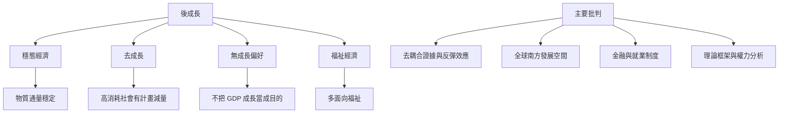

穩態經濟與去成長、後成長、福祉經濟、循環經濟有交集，但不能互相取代。研究也指出實證去耦合限制、金融成長強制爭論、全球南方結構依賴，以及穩態經濟理論本身的內部批判。

## 雙向連結
* [[後成長]]、[[去成長]]、[[無成長偏好]]、[[福祉經濟]]
* [[相對去耦合]]、[[絕對去耦合]]、[[充分性]]、[[地球限度]]
* [[相對去耦合不保證總體環境壓力下降]]
* [[全球南方需要發展空間而非被要求同步收縮]]
* [[金融體系的成長強制需要具體制度分析]]
* [[穩態經濟仍需接受多元經濟理論的批判]]
