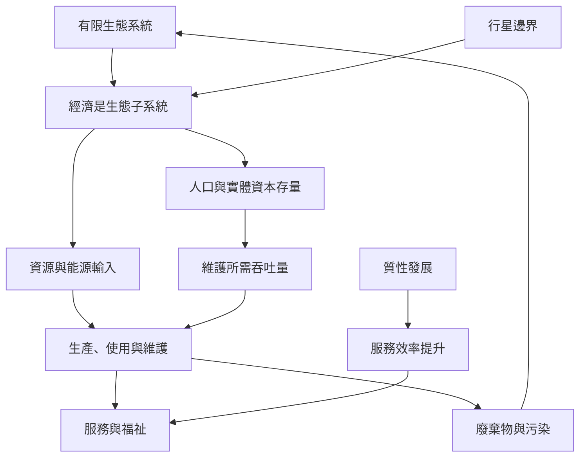

穩態經濟首先是一套有關經濟與生態系統關係的理論：經濟是有限生態圈中的子系統，必須在資源來源與污染吸收能力的限制下運作。Daly 將核心變數界定為人口、實體資本存量與吞吐量，並以服務／吞吐量描述質性進步。理解這張概念地圖時，先讀原始定義，再區分存量與流量、成長與發展，最後思考生態邊界與資源效率之間的關係。

**核心概念：** [[Steady_state_economy]]、[[Ecological_economics]]、[[Throughput]]、[[Stock_and_flow]]、[[Thermodynamic_economics]]、[[Planetary_boundaries]]、[[Material_footprint]]、[[Economic_growth]]、[[Qualitative_development]]、[[Uneconomic_growth]]。

**永久筆記：** [[經濟是生態系統內部的物質代謝子系統]]、[[存量與流量必須分開衡量]]、[[穩態經濟的穩定對象是物質吞吐量而非社會變化]]、[[經濟成長不等於經濟發展]]、[[穩態經濟的進步來自服務效率而非存量擴張]]、[[效率提升可能被規模擴張抵銷]]。

這張卡片是 [[Steady-state_economy]] 全書論證的一部分。

## 思與行
- 畫一張本地生活服務的物質代謝圖，追蹤食物、能源、建材、交通與廢棄物。
- 每一個效率方案都同時檢查總量是否下降，避免只改善單位指標。

## 參考
- [[穩態經濟以低吞吐量維持人口與實體資本存量]]、[[物質流量核算揭示貿易如何轉移環境負擔]]、[[歐洲環境署認為全球長期絕對脫鉤仍缺乏可信證據]]。
