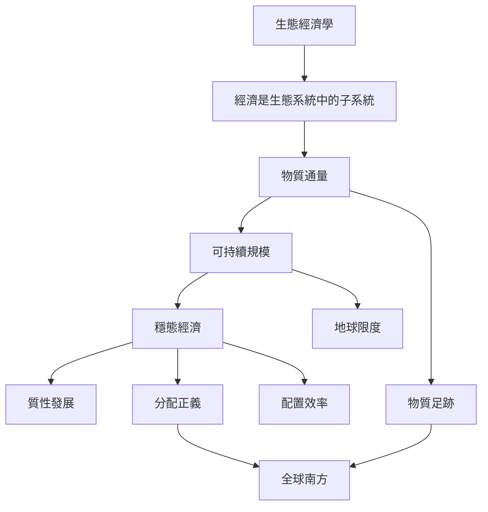

穩態經濟的理論骨架從經濟嵌入生態系統出發，以物質與能源通量描述經濟規模，再區分可持續規模、分配正義與配置效率。這張地圖適合先讀，建立本書的概念座標。

## 雙向連結
* [[穩態經濟]]、[[生態經濟學]]、[[物質通量]]、[[可持續規模]]
* [[分配正義]]、[[配置效率]]、[[質性發展]]、[[地球限度]]
* [[物質足跡]]、[[全球南方]]、[[生態足跡]]
* [[穩態經濟的核心是穩定物質規模而非凍結社會變化]]
* [[經濟是生態系統中的子系統]]
* [[經濟規模、分配與配置是三種不同的政策問題]]
* [[物質通量是經濟規模的生態指標]]
* [[質性發展可以在物質規模穩定時持續]]
