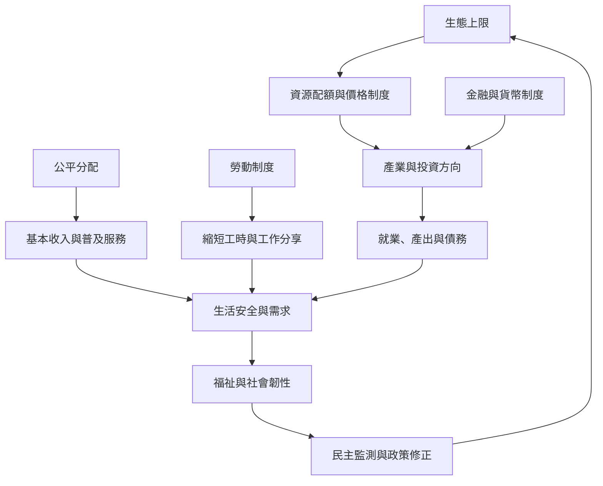

穩態經濟不能只要求個人少消費；它需要改變宏觀制度如何創造就業、分配所得、融資、投資與供應公共服務。政策工具必須成套設計：資源總量上限、稅制改革、收入分配、工時調整、公共投資、金融制度與社會保障相互影響。

**核心概念：** [[Cap_and_trade]]、[[Ecological_tax_reform]]、[[Just_transition]]、[[Social_provisioning]]、[[Sufficiency]]、[[Post_growth]]。

**永久筆記：** [[生態規模公平分配與配置效率是三個不同政策問題]]、[[充分性與普及服務比消費擴張更能直接保障生活]]、[[沒有總量成長時宏觀經濟仍須保障就業與收入]]、[[縮短工時可以把生產力收益轉化為自由時間]]、[[循環經濟無法取代對總量吞吐的限制]]。

這張卡片是 [[Steady-state_economy]] 全書論證的一部分。

## 思與行
- 對任何政策組合進行宏觀情境測試，並以實際試辦和分配資料校正模型。
- 把資源上限與基本服務設計為同一政策包，確保生態限制不轉嫁給脆弱群體。

## 參考
- [[穩態經濟必須同時限制資源規模並保障公平分配]]、[[無成長情境需要重新設計就業投資與金融制度]]、[[2024年系統性回顧提醒退成長研究仍有方法與證據缺口]]。
