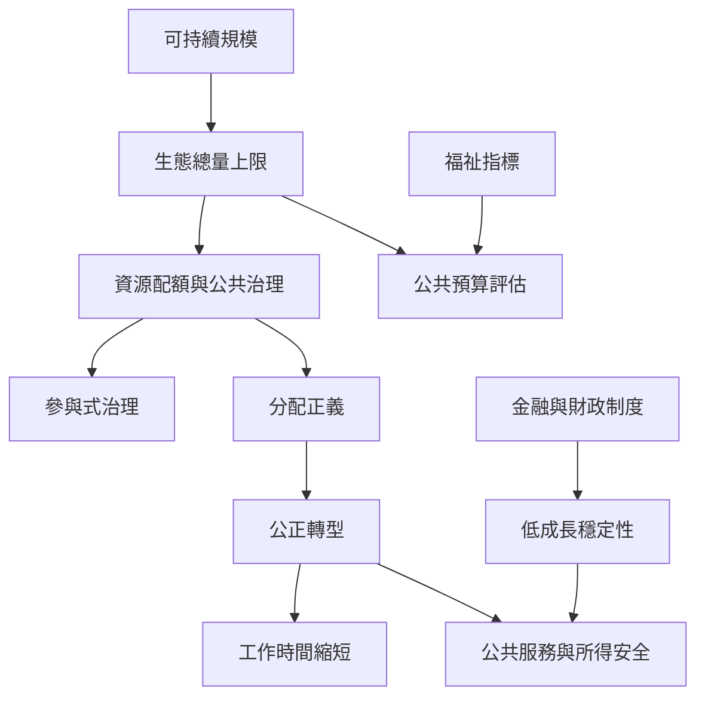

穩態轉型不是單一環境政策，而是將生態上限、分配、就業、金融、公共財政與民主治理放進同一套制度設計。此地圖從總量上限出發，連結公平分配與宏觀穩定。

## 雙向連結
* [[可持續規模]]、[[分配正義]]、[[公正轉型]]、[[參與式治理]]
* [[共同池資源]]、[[工作時間縮短]]、[[福祉經濟]]、[[GDP]]
* [[穩態轉型必須處理就業與所得安全]]
* [[金融體系的成長強制需要具體制度分析]]
* [[轉型必須結合民主參與與權力分析]]
* [[福祉指標必須與生態總量指標並列]]
* [[穩態經濟仍需接受多元經濟理論的批判]]
