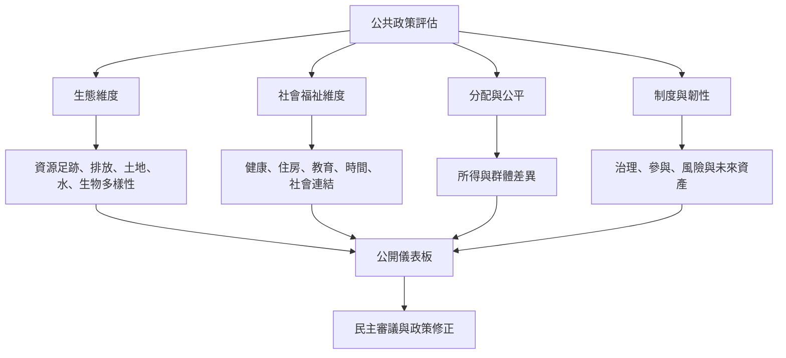

穩態經濟的測量不能只看 GDP，也不能只看資源消耗。合理的監測架構至少需要把生態上限、社會底線、分配差異、制度韌性與政策實施結果放在同一個公共討論框架內。行星邊界與安全且公正的發展空間提供生態與社會的參照；Beyond GDP、生活水準框架與福祉經濟則提供政策衡量入口。

**核心概念：** [[Beyond_GDP]]、[[Wellbeing_economy]]、[[Planetary_boundaries]]、[[Safe_and_just_space]]、[[Doughnut_economics]]、[[Gross_National_Happiness]]。

**永久筆記：** [[絕對脫鉤必須用消費足跡與全球總量驗證]]、[[低物質消耗不等同低生活品質但服務制度必須改善]]、[[GDP之外的儀表板必須避免把複合指數當終極目標]]、[[穩態需要動態調整與生態韌性而不是僵硬恆定]]、[[城市與社區可以成為低吞吐社會供給的試驗場]]。

這張卡片是 [[Steady-state_economy]] 全書論證的一部分。

## 思與行
- 將指標分成生態、社會、分配與治理四層，保留不同維度之間的衝突資訊。
- 在地方實驗中同步記錄資源投入、服務成果、參與公平、時間成本與維護需求。

## 參考
- [[基本需求可以在降低生態壓力的條件下獲得更公平的滿足]]、[[穩態轉型需要同時衡量物質指標與社會指標]]、[[聯合國2026年BeyondGDP倡議提出以福祉與地球為核心的指標儀表板]]、[[紐西蘭生活水準框架把當代福祉與未來資產放在一起評估]]。
