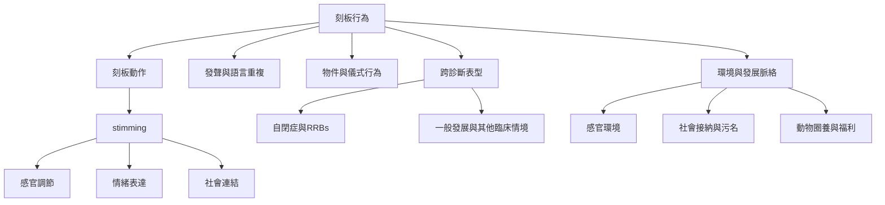

刻板行為是一種可跨越人類與非人動物、神經發展與環境研究的重複行為現象。理解時需要把行為形式、個體經驗、發展背景、情境功能與社會評價拆開，再重新組合。

核心概念：[[刻板行為]]、[[刻板動作]]、[[stimming]]、[[受限與重複行為]]、[[感官調節]]、[[感官處理差異]]、[[功能評估]]、[[神經多樣性]]、[[動物刻板行為]]。

關聯筆記：[[外觀相似的重複動作不代表具有相同功能]]、[[重複動作是跨診斷表型而不是自閉症專屬指標]]、[[刻板動作與刻板動作障礙不是同一層次的概念]]。

回到主題：[[Stereotypy]]
