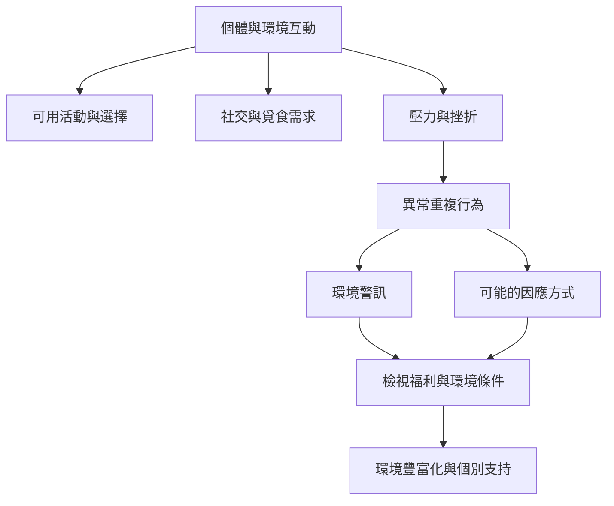

動物行為研究指出，重複模式有時反映受限環境，有時也可能成為個體因應環境的方式。這個脈絡提供生態視角，但不能直接將動物福利模型套用於自閉者。

核心概念：[[動物刻板行為]]、[[環境豐富化]]、[[動物福利]]、[[支持組裝]]。

關聯筆記：[[動物刻板行為可作為環境福利警訊但不是單一福利分數]]、[[人類與動物研究的類比應限於環境與行為的分析層次]]、[[非人靈長類異常重複行為受到個體與飼養環境共同影響]]。

回到主題：[[Stereotypy]]
