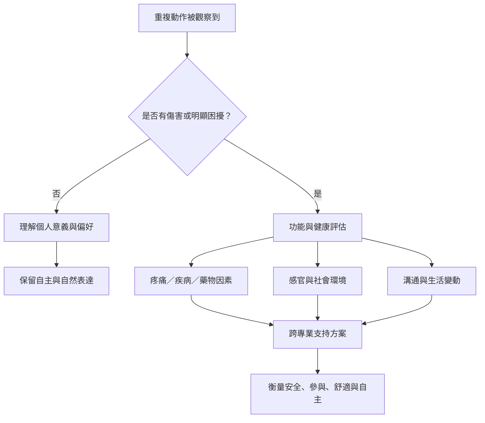

臨床評估需要區分行為現象、診斷類別與支持目標。刻板動作本身不等於障礙；若出現疼痛、自傷或顯著生活干擾，才需要進一步釐清成因與安全支持。

核心概念：[[刻板動作障礙]]、[[功能評估]]、[[自傷行為]]、[[感官調節]]、[[感官友善設計]]。

關聯筆記：[[刻板動作與刻板動作障礙不是同一層次的概念]]、[[功能評估應辨識需求而非只記錄頻率]]、[[支持應先改變造成困難的環境條件而非直接消除動作]]。

回到主題：[[Stereotypy]]
