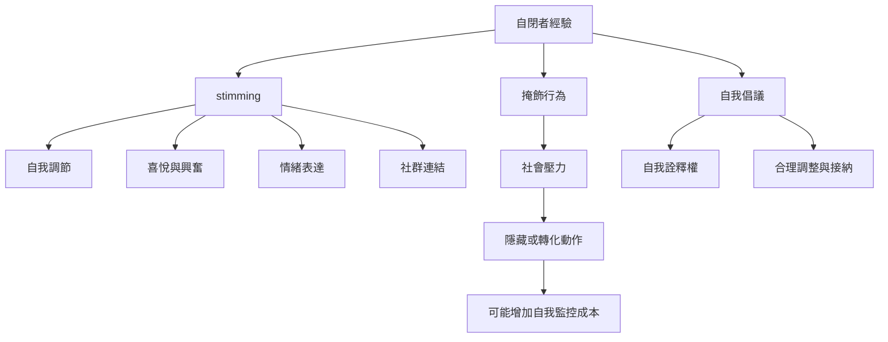

在自閉者經驗脈絡中，stimming 不只是臨床清單中的重複動作，也可能是自我調節、情緒表達、專注、身份與關係實踐。社會接納會影響人們能否在公共情境中自然表達。

核心概念：[[stimming]]、[[掩飾行為]]、[[污名]]、[[神經多樣性]]、[[社會規範]]、[[自閉者應是自身行為意義與支持目標的主要詮釋者]]。

關聯筆記：[[stimming不只具有自我調節功能也可能建立社會連結]]、[[社會規範會改變stimming的可見程度與表達方式]]、[[抑制無害stimming可能把社會不適轉嫁給個人]]、[[非傷害性動作的介入門檻應高於社會觀感不適]]。

回到主題：[[Stereotypy]]
