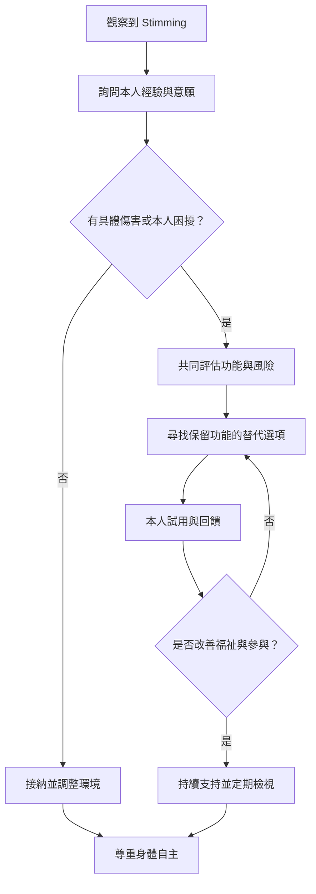

支持 stimming 的倫理判斷，應先區分無害差異、本人困擾與具體風險，再考慮本人意願、替代方式和介入代價。減少動作本身不是普遍目標，支持的目的應是改善生活品質、參與及安全。

相關概念：[[term/身體自主]]、[[term/功能性行為評估]]、[[term/社會效度]]、[[term/神經多樣性典範]]。

## 思與行
* 任何介入先回答：具體問題是什麼？誰認為它是問題？有沒有傷害較小的方案？本人是否同意？
* 若需要調整，聚焦安全、舒適與參與，而非外表正常化。

## 參考
* [[note/支持應調整風險而不是把差異本身視為問題]]
* [[note/介入成果應以本人福祉而非外表正常化衡量]]
* [[data/美國醫學倫理文章主張不要把看起來正常當成介入成果]]
* [[data/2026 年介入回顧顯示中斷與轉向策略的證據品質和倫理紀錄不一]]
