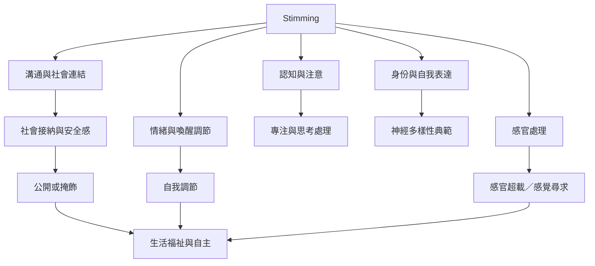

Stimming 是一組因人而異的身體實踐，可能涉及感官輸入、情緒、認知、身份與溝通。這張地圖將各層次視為互相影響，而非單一路徑因果。

相關概念：[[term/Stimming]]、[[term/感覺處理]]、[[term/自我調節]]、[[term/情緒調節]]、[[term/感官超載]]、[[term/掩飾與偽裝]]、[[term/自閉症身份]]、[[term/身體自主]]。

## 思與行
* 閱讀任何 stimming 研究時，檢查它是否只測量一個面向，例如動作頻率，而忽略身份、溝通或環境。
* 可把此圖當作訪談框架，但允許受訪者提出圖中沒有的新功能。

## 參考
* [[note/Stimming 是一組身體實踐而不是單一症狀]]
* [[note/Stimming 的功能必須由當事人與情境共同界定]]
* [[data/2026 年訪談研究把 Stimming 描述為身份、安全與連結的多重實踐]]
