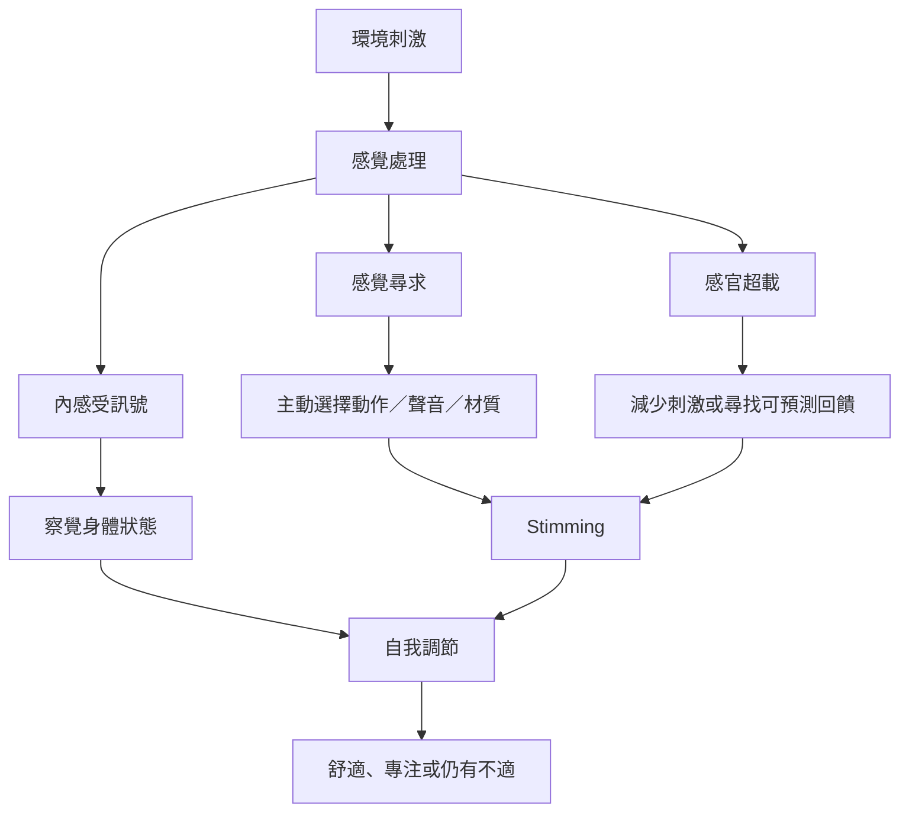

感官調節地圖呈現不同感官系統如何與動作、環境及主觀感受互動。它不代表每個 stim 都能被精確歸入某一感官，也不表示感官輸入是 stimming 的唯一成因。

相關概念：[[term/感覺處理]]、[[term/感覺尋求]]、[[term/感官超載]]、[[term/本體覺]]、[[term/前庭覺]]、[[term/內感受]]、[[term/自我調節]]。

## 思與行
* 觀察一個人時，同時留意外在環境和內在身體訊號，不能只把動作當成問題來源。
* 以本人感受來驗證某項感官策略是否有效。

## 參考
* [[note/Stimming 可以調節感官輸入也可能增加可預測的身體回饋]]
* [[data/印度家長的感官經驗研究提醒評估工具必須符合在地脈絡]]
* [[data/世界衛生組織的 ICD-11 描述把感官反應納入自閉症臨床特徵]]
