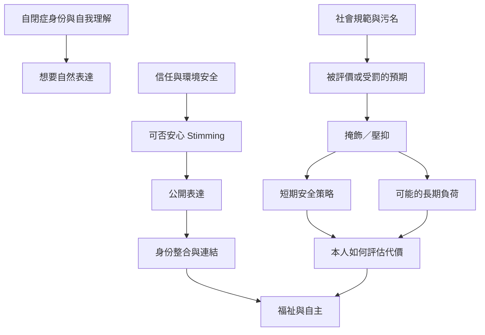

Stimming 的公開程度不只由個人需求決定，也受到關係與環境影響。當一個人覺得安全、被理解且不會因此失去機會，較可能自在表達；在污名、控制或不確定環境中，則可能隱藏自己的動作。

相關概念：[[term/自閉症身份]]、[[term/掩飾與偽裝]]、[[term/神經多樣性典範]]、[[term/身體自主]]、[[term/社會效度]]。

## 思與行
* 讓安全感成為空間設計與服務品質的評估指標。
* 了解掩飾是個體可能採取的情境策略，不要要求每個人都在所有場合公開 stimming。

## 參考
* [[note/Stimming 不只是調節感官也是身份表達與關係溝通]]
* [[note/壓抑 Stimming 可能是社會適應策略而非本人偏好]]
* [[data/自閉症成人認為 Stimming 有時愉悅有時困難且壓抑多來自外在評價]]
