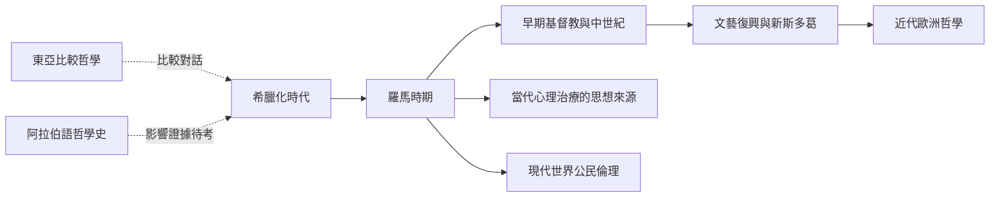

斯多葛主義從希臘化時代的學派發展為羅馬時期的生活哲學，後來被基督教作者、修道傳統與近代歐洲哲學家選擇性吸收。當代也出現與中國思想比較及心理科學研究的對話；這些關係需依證據強度分層描述。

可由 [[斯多葛主義]]、[[新斯多葛主義]] 與 [[精神操練]] 建立歷史骨架，再讀 [[斯多葛思想在東西方比較中可與陽明學對話，但不可混為一談]]、[[斯多葛主義在近代歐洲被重新詮釋，而非原樣復活]] 及 [[跨文化思想史必須區分接觸、吸收與直接影響]]。
