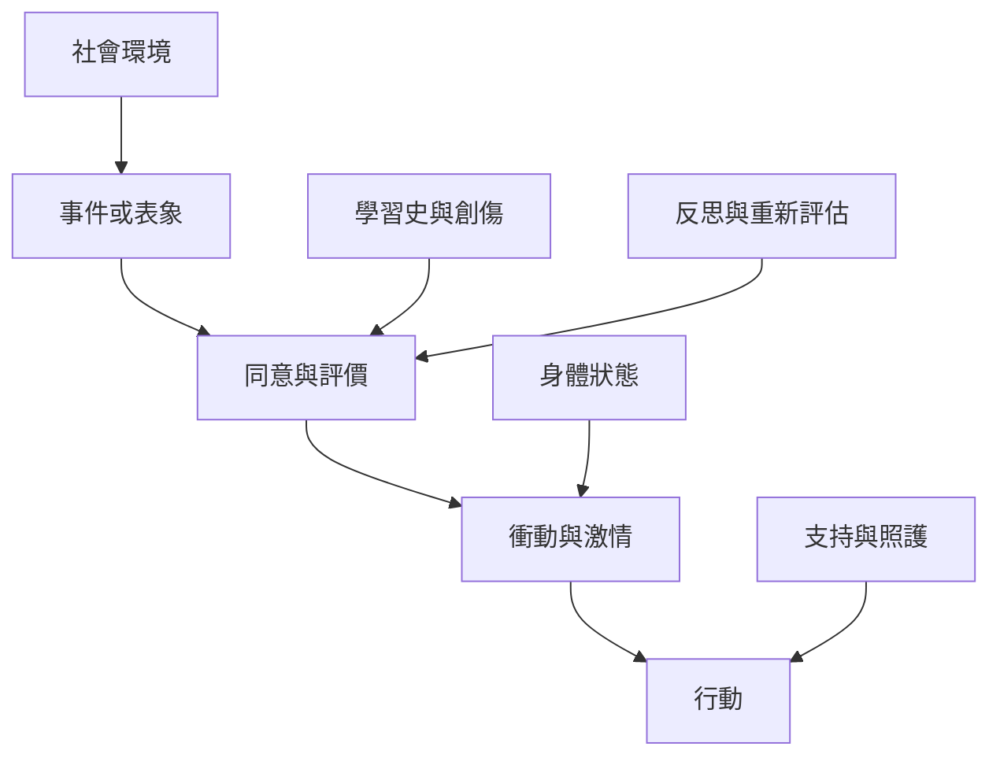

古典斯多葛將激情與價值判斷、同意及衝動相連；現代心理學則提供情緒、生理與社會脈絡的多層次說明。對話的關鍵是既保留判斷反省，也避免把痛苦歸咎於個人。

核心概念包括 [[激情與情緒]]、[[同意]]、[[無激情]] 與 [[認知行為治療]]。閱讀時搭配 [[情緒並非敵人，斯多葛修養在於檢視情緒背後的價值判斷]]、[[重新檢視判斷能降低情緒反應，但情緒不只是思考錯誤]]，並參照 [[斯多葛哲學與認知行為治療有歷史關聯，但兩者並非同一套方法]]。
