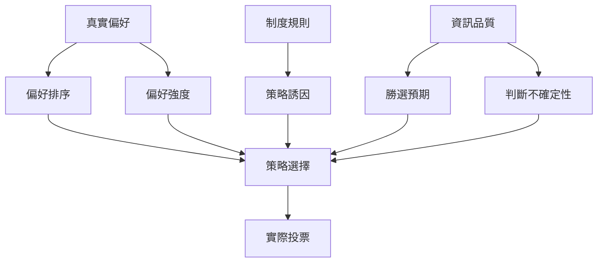

這張概念地圖聚焦選民如何在真實偏好、偏好強度、勝選預期與結果效用之間做選擇。策略投票不是單一心理特質，而是偏好與信念在特定選制下互相作用的行為。

可從[[策略投票是把真實偏好轉換成預期結果的選擇]]開始，接著閱讀[[策略投票只有在選民相信選票可能改變結果時才有工具性誘因]]、[[偏好強度會影響選民是否願意轉投第二選擇]]、[[策略投票測量必須先辨認真正面臨策略選擇的選民]]。相關定義見[[策略投票]]、[[戰術投票]]、[[真誠投票]]、[[廢票效應]]。

案例依據：[[加拿大研究顯示強烈政黨偏好會抑制策略轉投]]、[[加拿大研究發現教育與收入較高者較常採取策略投票]]、[[策略投票研究必須區分偏好、勝選預期與制度誘因]]。
