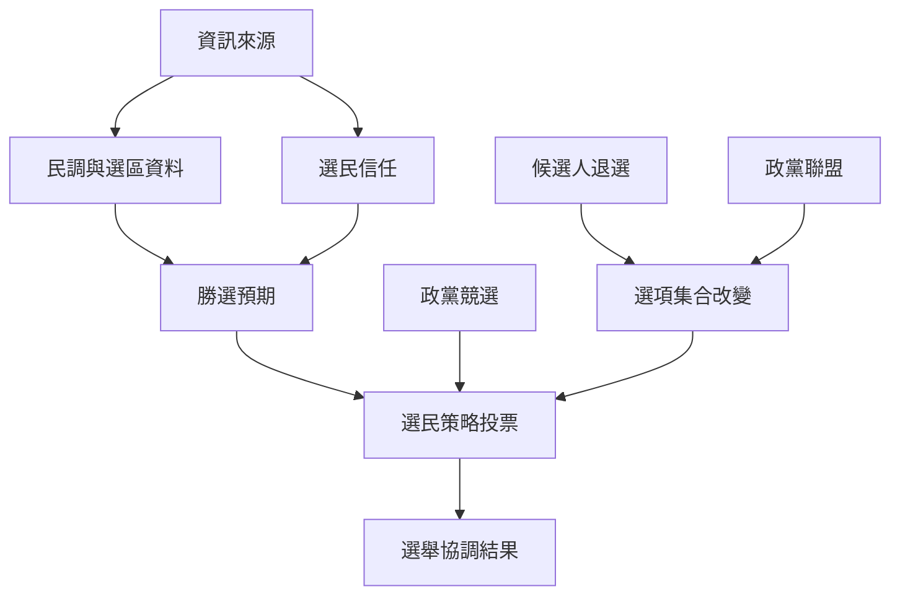

這張概念地圖關注策略投票如何受到資訊、民調、政黨競選、候選人退選與集體協調影響。個別選民的策略判斷會聚合成選舉結果，而策略資訊本身也可能改變選民預期。

先讀[[策略投票的品質取決於資訊可得性與不確定性管理]]，再讀[[策略投票與選舉協調必須分成選民政黨與制度三個層次]]與[[策略投票可能擴大政治資訊資源的不平等]]。研究案例包括[[東亞實驗顯示民調來源與誤差呈現會影響策略投票]]、[[英國研究指出競選接觸與選區資訊會影響選民忠誠或轉投]]、[[法國兩輪選舉讓策略轉投與政黨協調在兩輪之間發生]]。

延伸思考可閱讀[[把策略投票理解成集體行動中的協調難題]]、[[建立地方選區策略資訊的可信任透明標示]]、[[把棄保討論改寫成多方風險情境對話]]。相關概念見[[民調不確定性]]、[[選舉協調]]、[[策略操弄]]。
