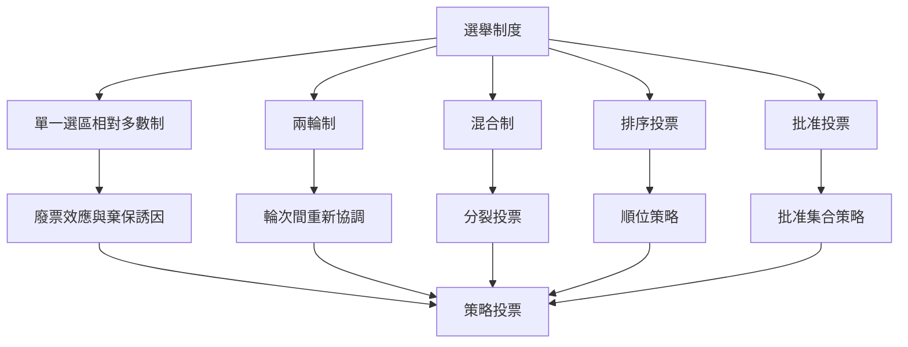

這張概念地圖比較不同制度如何改變選民能表達的資訊、票數轉換方式與策略誘因。制度的效果取決於選區規模、計票規則、候選人數、淘汰程序與政黨結構，不能只用「單選」或「排序」概括。

理論入口是[[杜瓦傑法則把選制效果分成機械效果與心理效果]]與[[社會選擇理論指出具多個選項的民主制度難以完全免於策略操弄]]。比較研究可讀[[即時決選投票與相對多數制的策略誘因並非簡單高低]]、[[策略投票的發生機率與收益大小是兩個不同問題]]、[[複數投票制度的實驗顯示策略行為依計票規則而異]]、[[批准投票可能改善協調結果但仍須考慮策略互動]]。

區域案例包括[[台灣早期選舉研究指出總統選舉與立委選制會形塑不同策略]]、[[德國雙票制把選區候選人選擇與政黨席次比例分開]]、[[澳洲偏好投票允許排序但不等於沒有策略問題]]、[[法國兩輪選舉讓策略轉投與政黨協調在兩輪之間發生]]。概念定義見[[單一選區相對多數制]]、[[即時決選投票]]、[[批准投票]]、[[單一選區兩票制]]、[[混合選制]]、[[比例代表制]]、[[選舉門檻]]、[[偏好排序]]、[[Gibbard–Satterthwaite定理]]。
