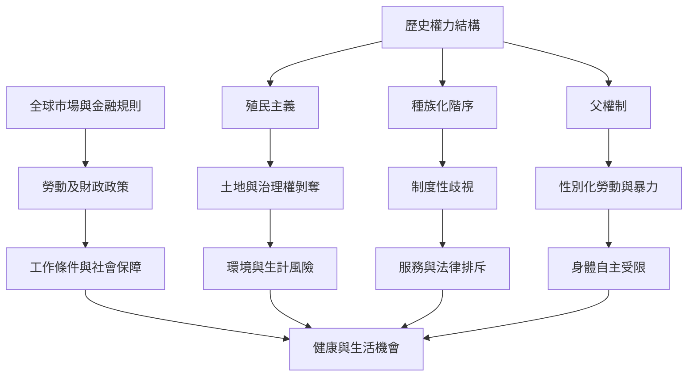

此圖聚焦權力結構如何透過歷史制度與現代經濟組織塑造風險。殖民治理、種族化與父權關係可能彼此交織；土地和勞動控制進一步影響環境、醫療、法律身分與生計。圖示是研究問題的導航，不代表每個案例都有同一條固定因果路徑。

## 思與行
* 選取一個地區案例，先辨認其歷史脈絡，再追蹤制度如何延續到當代政策和日常生活。
* 用[[交織性]]檢查不同權力關係如何共同作用，並納入社群自身的抵抗與治理方案。

## 參考
* [[殖民治理會把土地剝奪轉化為持續性的健康風險]]。
* [[全球供應鏈把市場風險與勞動傷害不成比例地轉嫁給工人]]。
* [[交織性揭示多種權力如何共同配置風險]]。
* 概念定義：[[殖民主義]]、[[定居殖民主義]]、[[交織性]]、[[結構性種族主義]]、[[政治經濟學]]。
